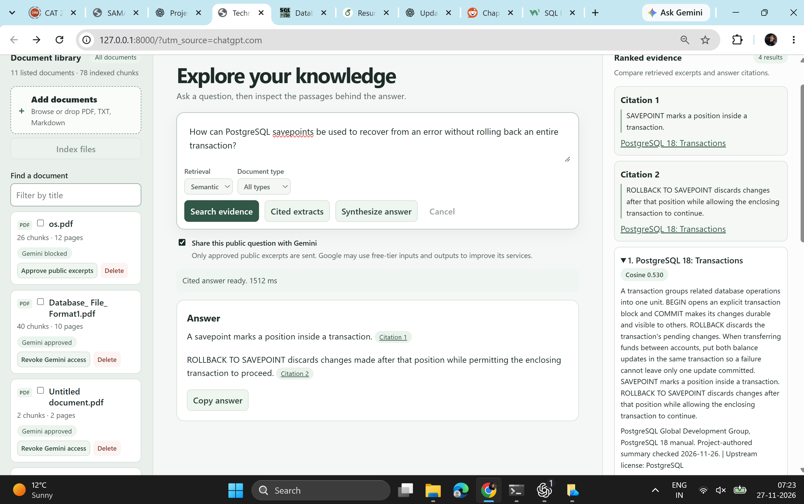
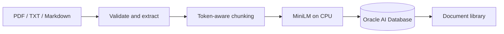
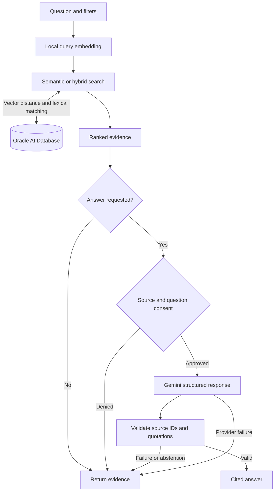
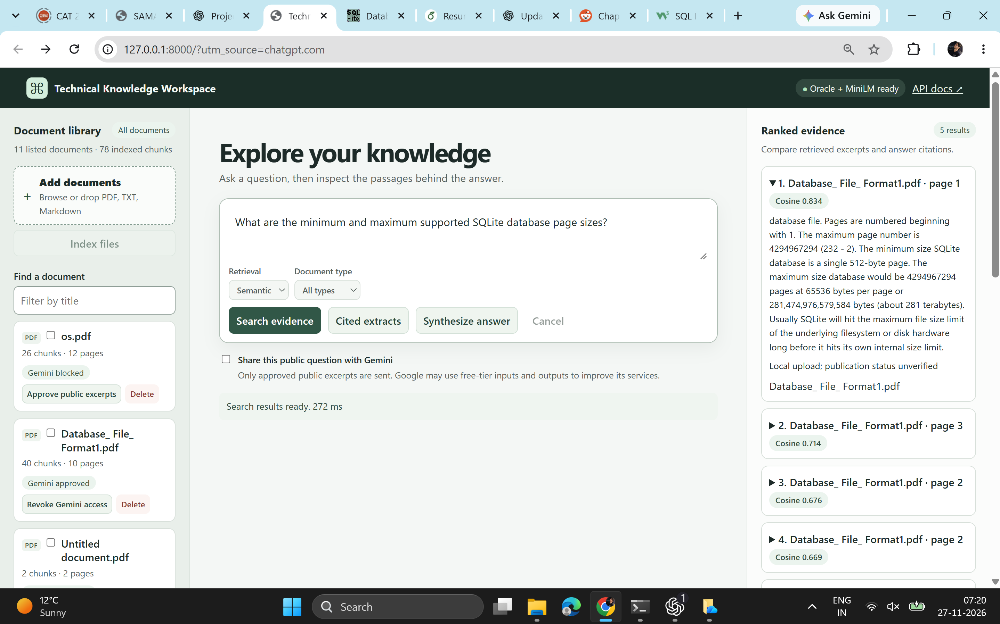
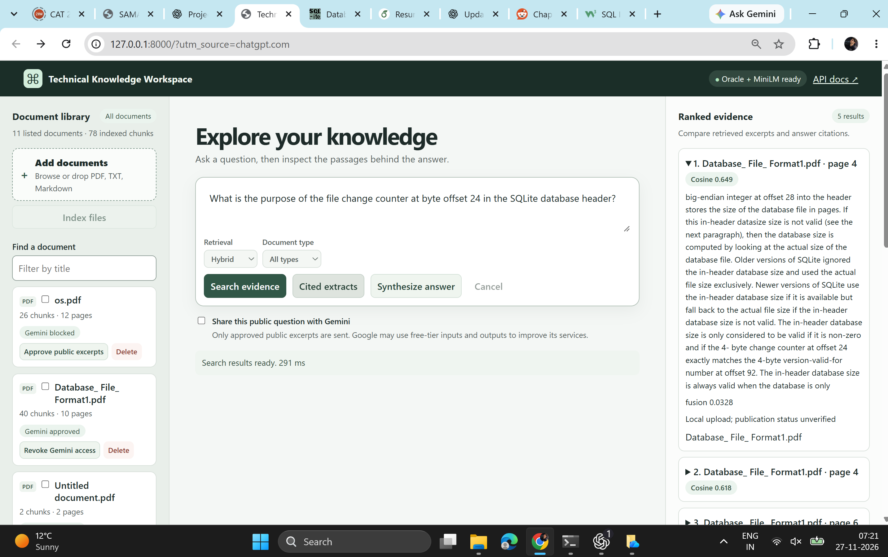
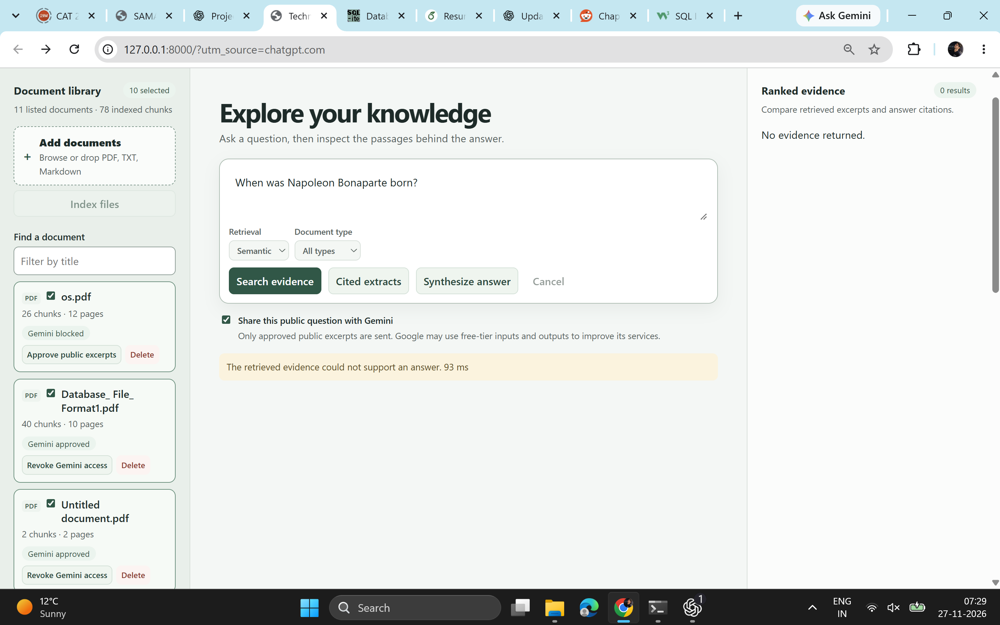
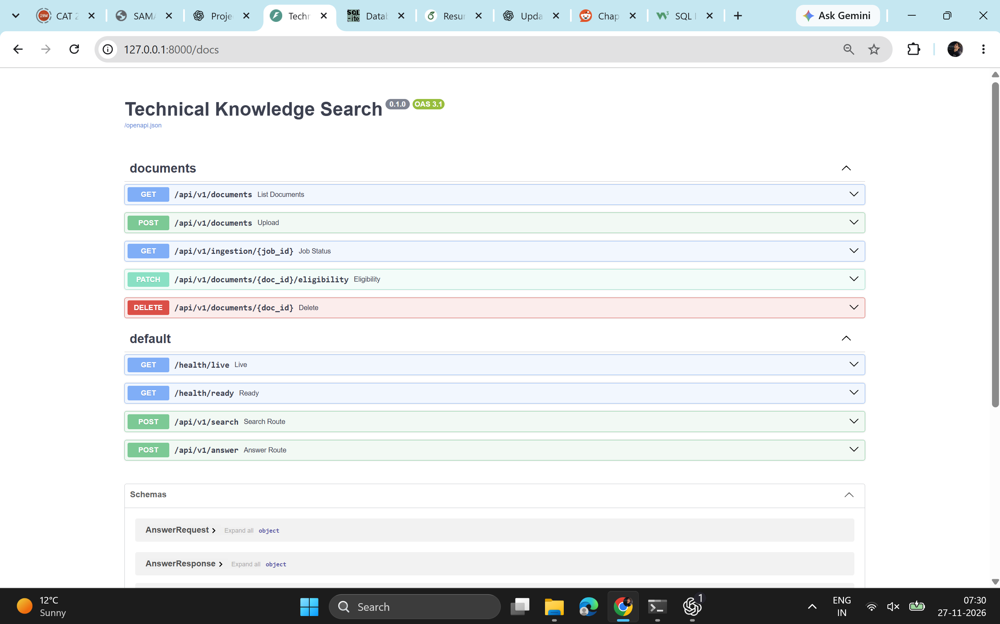

# Technical Knowledge Workspace

A RAG application for searching technical documentation and generating answers backed by source excerpts. Built with Python, FastAPI, Oracle AI Vector Search, local MiniLM embeddings and Gemini.

Database manuals and operational runbooks often contain related information across several pages or documents. This project brings those passages together, lets users inspect their relevance, and provides citations alongside generated answers. Search works independently of the language model.



*Local application run: PostgreSQL savepoint question, two source citations and a reported response time of 1,512 ms.*

## Features

- **Document ingestion:** PDF with selectable text, TXT and Markdown; background indexing, duplicate detection, document metadata and page-level references.
- **Retrieval:** exact cosine search over 384-dimensional embeddings, hybrid lexical and semantic ranking, document filters and configurable top-K results.
- **Answer generation:** extractive and synthesis modes, source citations, explicit unanswered parts and evidence-only fallback when generation fails or is blocked.
- **Privacy:** document-level sharing eligibility and per-question consent before excerpts or questions are sent to Gemini.
- **Backend reliability:** Oracle connection pooling, bounded model concurrency, request deadlines, rate limiting, input validation, health endpoints and sanitized request IDs.

## Architecture

### Document ingestion



Text is split into overlapping token windows while preserving document provenance and PDF page metadata. MiniLM produces normalized 384-dimensional embeddings, stored alongside the text and metadata in Oracle's native VECTOR columns.

### Retrieval and answer generation



The browser communicates with FastAPI. Retrieval, context selection and provider integration are implemented directly in Python rather than delegated to a RAG orchestration framework.

For more detail, see the [high-level design](docs/ARCHITECTURE_HLD.md), [low-level design](docs/ARCHITECTURE_LLD.md) and [system design notes](docs/SYSTEM_DESIGN.md).

## Engineering decisions

| Decision | Rationale |
|---|---|
| Local MiniLM embeddings | CPU inference avoids an external embedding service and its per-request cost. |
| Native Oracle vectors | Keep text, document metadata and embeddings together, with SQL-based filtering. |
| Exact cosine search | Establish a measurable retrieval baseline before introducing approximate vector indexes. |
| Hybrid retrieval | Reciprocal rank fusion combines semantic ranking with lexical matches for identifiers, numbers and technical terms. |
| Direct Python implementation | Keep retrieval, context budgeting, citation checks and provider failure handling explicit. |
| Bounded concurrency | Limit resource contention between interactive retrieval and document ingestion. |
| Citation checks | Reject unknown source IDs and quotations that do not match supplied evidence. |
| Explicit sharing consent | Keep retrieval usable without sending document excerpts to the external generation provider. |

Additional trade-offs are documented in [architecture decisions](docs/ARCHITECTURE_DECISIONS.md).

## Application walkthrough

Screenshots below show local application runs unless explicitly marked as a fixture. Reported response times are individual observations, not benchmarks.

### Document library and ingestion


Upload a document, track indexing progress, inspect page and chunk counts, and select the documents to search. This screenshot uses an authored browser fixture.

### Semantic retrieval



The top-ranked passage has a cosine similarity of 0.834; the interface reports 272 ms for this search.

### Hybrid retrieval



The top-ranked passage discusses the change counter at offset 24. The interface displays cosine similarity and reciprocal rank fusion scores separately.

### Insufficient evidence



The application abstains when the indexed documents cannot support an answer. Document and question consent also gate external generation.

## Evaluation

| Check | Recorded result |
|---|---|
| Windows regression suite | 67 passed, 2 skipped |
| Seed retrieval evaluation | 8/8 expected sources ranked first |
| Seed Recall@3 and MRR@3 | 1.00 on eight positive questions |
| Unrelated seed questions | 4/4 returned no evidence |
| Warm retrieval latency | 81.46 ms median over 12 sequential seed requests |
| Cross-document synthesis | Retrieved and cited both requested sources in a two-document query |

The regression run used real Oracle and cached MiniLM; persistent upload and live Gemini tests were opt-in skips. Separate live Gemini runs are documented in the evaluation record. The latency and retrieval figures come from a small historical seed evaluation, not a large-scale benchmark or load test.

See [evaluation results](EVALUATION_RESULTS.md) for test flags, methodology, capacity probes, hybrid comparisons and observed failure cases.

## Technology stack

| Layer | Technology |
|---|---|
| API | Python 3.11, FastAPI, Uvicorn |
| Database | Oracle AI Database, python-oracledb |
| Embeddings | Sentence Transformers, all-MiniLM-L6-v2, PyTorch CPU |
| Generation | Gemini, Google Gen AI SDK |
| Document processing | pypdf, token-aware text chunking |
| Frontend | HTML, CSS, JavaScript |
| Testing and packaging | pytest, Dockerfile, Docker Compose (runtime verification pending) |

## Getting started

### 1. Install dependencies

Use Python 3.11 on Windows and an existing vector-capable Oracle database. The application does not provision cloud resources.

```powershell
git clone https://github.com/SamayJain8/technical-knowledge-workspace.git
cd technical-knowledge-workspace
python -m venv .venv
.venv/Scripts/python -m pip install -r requirements.txt
Copy-Item .env.example .env
.venv/Scripts/python -m app.smoke model --download
```

### 2. Configure Oracle

Set `ORACLE_USER`, `ORACLE_PASSWORD`, `ORACLE_DSN` and the applicable wallet or TLS settings in your local `.env`. Use a dedicated schema and keep credentials and wallets outside version control.

Follow the [Oracle setup guide](docs/ORACLE_SETUP.md) for owner, reader and writer configuration. On a **new empty project schema**, run as its owner:

```powershell
.venv/Scripts/python -m app.smoke oracle --init-schema
.venv/Scripts/python -m app.migrate_library
.venv/Scripts/python -m app.ingest
```

Oracle DDL commits automatically; inspect an existing schema before applying migrations. Switch to the runtime credentials described in the setup guide before starting the application.

### 3. Configure generation (optional)

Set `LLM_PROVIDER`, `LLM_MODEL` and `GEMINI_API_KEY` in `.env` to enable Gemini. Evidence-only search does not require a Gemini key.

Uploaded text and vectors persist in Oracle. Approved excerpts and the question may be sent to Gemini for token counting and generation. Use public material for external generation and review the [provider data terms](https://ai.google.dev/gemini-api/terms).

### 4. Start the application

```powershell
.venv/Scripts/python -m uvicorn app.main:app --host 127.0.0.1 --port 8000 --workers 1 --limit-concurrency 8 --no-access-log
```

Open [localhost:8000](http://127.0.0.1:8000/) and try searching the bundled corpus with:

> How can I undo part of a transaction?

### 5. Run tests

```powershell
.venv/Scripts/python -m pytest -q -rs
```

Live model, Oracle, persistent upload and Gemini tests are opt-in. See the [testing guide](docs/EVALUATION_AND_TESTING.md) and [evaluation record](EVALUATION_RESULTS.md) for configuration and commands.

## API

Interactive Swagger documentation is available at [localhost:8000/docs](http://127.0.0.1:8000/docs) while the application is running.

| Method | Endpoint | Purpose |
|---|---|---|
| GET | `/health/live`, `/health/ready` | Liveness and Oracle/MiniLM readiness |
| GET | `/api/v1/documents` | List indexed documents |
| POST | `/api/v1/documents?name=…` | Upload raw document bytes |
| GET | `/api/v1/ingestion/{job_id}` | Ingestion progress |
| PATCH | `/api/v1/documents/{id}/eligibility` | External sharing eligibility |
| DELETE | `/api/v1/documents/{id}` | Remove an uploaded document |
| POST | `/api/v1/search` | Ranked evidence |
| POST | `/api/v1/answer` | Cited answer generation |



See the [API and integration registry](docs/API_AND_INTEGRATION_REGISTRY.md) for details.

## Repository structure

| Path | Responsibility |
|---|---|
| `app/main.py` | FastAPI routes and request handling |
| `app/ingest.py`, `app/library.py`, `app/corpus.py` | Seed and uploaded-document ingestion |
| `app/embeddings.py`, `app/search.py` | Embedding inference and retrieval |
| `app/oracle.py` | Database connections |
| `app/answer.py`, `app/gemini.py` | Evidence selection, generation and citation checks |
| `app/ui/` | Browser interface |
| `sql/`, `corpus/` | Schema migrations and seed documents |
| `tests/`, `evaluation/` | Regression tests and evaluation probes |
| `docs/` | Architecture, setup and engineering documentation |

## Current limitations

This is a local, single-user development preview, intended for trusted loopback access rather than public deployment.

- Uploads are bounded; scanned PDFs requiring OCR are unsupported.
- Ingestion progress is not durable across restarts.
- Citation checks verify source identity and quotation accuracy, not full semantic entailment or guaranteed multi-part answer coverage.
- Dedicated Oracle runtime roles and Linux/Docker runtime execution still require live verification.
- Multi-user isolation and large-scale performance have not been implemented or established.

See [known limitations](KNOWN_LIMITATIONS.md) and [project status](PROJECT_STATUS.md).

## Development roadmap

| Stage | Scope | Status |
|---|---|---|
| V1 — Document intelligence | Document ingestion, semantic and hybrid retrieval, cited generation and privacy controls | Published development preview |
| V1 — Scalability extension (M3.2) | Bulk ingestion of larger PDFs, folders and CSV/JSON/JSONL datasets; named collections, resumable jobs and retrieval benchmarks at 1,000–10,000 vectors | Planned |
| V2 — Agentic database investigation | Read-only SQL tools, tool calling, LangGraph orchestration, investigation state and multi-step evidence gathering | Planned |

Further improvements to evidence selection, multi-part answer coverage and query history are also planned.

The [scalability roadmap](docs/SCALABILITY_ROADMAP.md) describes the planned progression.

## Sources and license

The [seed corpus](corpus/README.md) contains attributed, project-authored summaries. The [pinned MiniLM model card](https://huggingface.co/sentence-transformers/all-MiniLM-L6-v2/blob/1110a243fdf4706b3f48f1d95db1a4f5529b4d41/README.md) describes the Apache-2.0 model.

Application code is licensed under [MIT](LICENSE).
