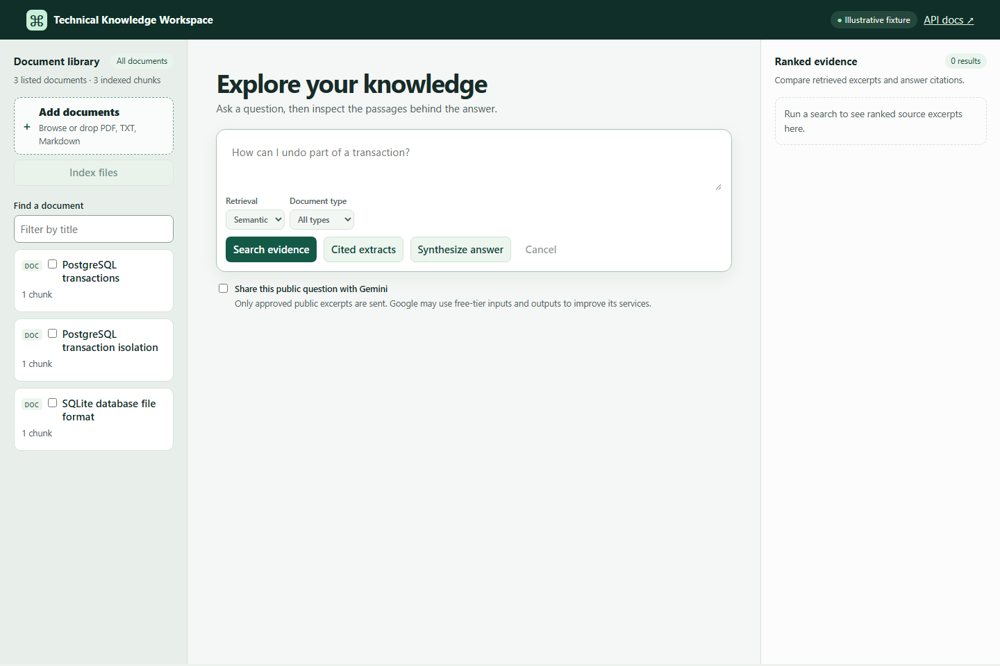
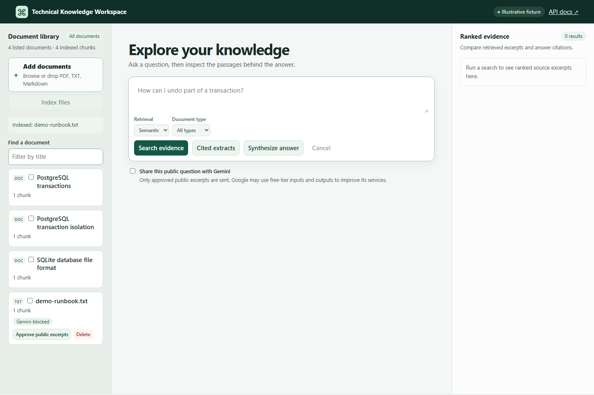
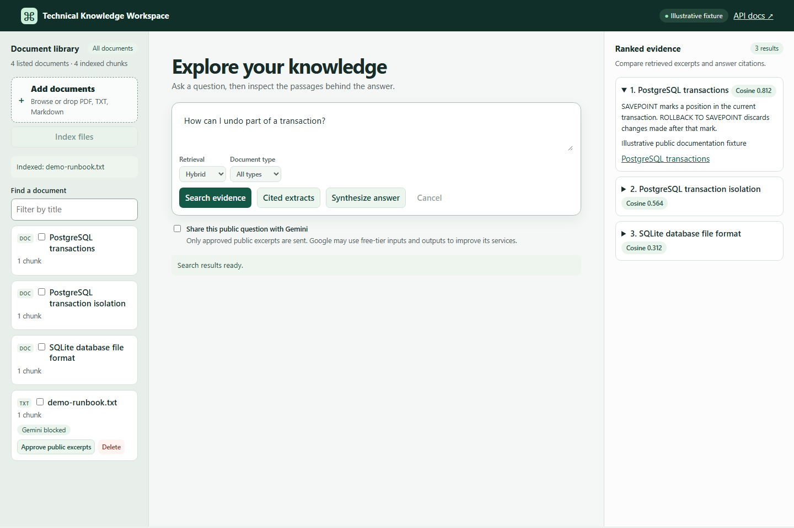
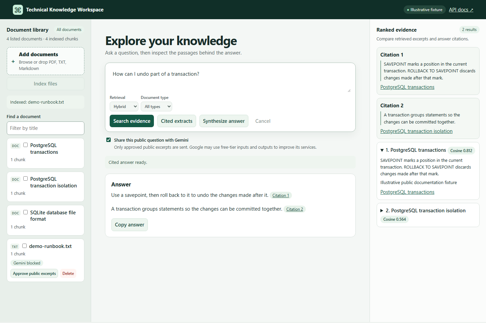
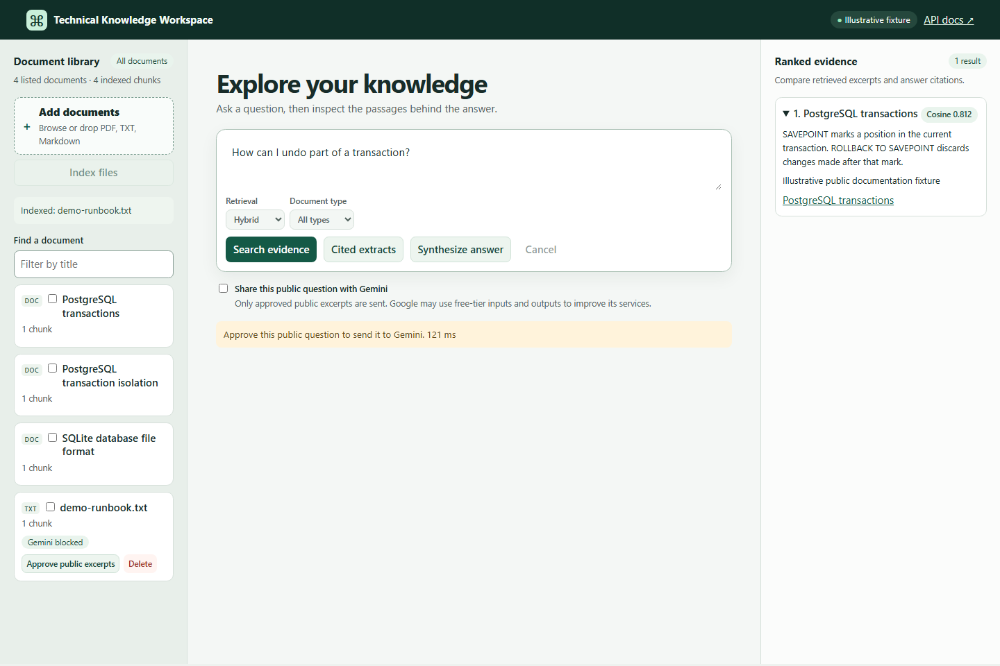
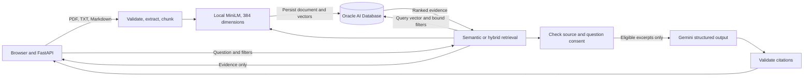

# Technical Knowledge Workspace

**Development preview · Local, single-user RAG application**

Database manuals often put an answer across several pages or documents. This
workspace indexes technical material, retrieves relevant excerpts, and shows
the source beside the answer so you can check it. It runs MiniLM locally for
embeddings, stores and ranks vectors in Oracle, and optionally uses Gemini
for cited answers.



*Chrome screenshot using project-authored fixture responses. It illustrates
the interface with no private documents or live provider traffic.*

### Demonstration gallery

All screenshots use authored local fixtures. Live Oracle, MiniLM and
Gemini verification is reported separately in the [evaluation record](EVALUATION_RESULTS.md).

| Document ingestion | Ranked retrieval |
|---|---|
|  |  |
| The upload job reports indexing completion and refreshes the document library. | Hybrid search exposes rank, cosine similarity, source links, and expandable text. |

| Cited synthesis | Privacy gate |
|---|---|
|  |  |
| Answer claims link to quotations from two fixture sources. | With question consent off, generation is blocked and retrieved evidence remains visible. |

## What works

- Upload PDF with selectable text, TXT, or Markdown. Track ingestion, detect
  duplicate content, filter the document library, and select search scope.
- Compare exact semantic cosine search with hybrid lexical and semantic
  ranking. Inspect ranked excerpts, cosine scores, provenance, and PDF pages.
- Request cited extracts or synthesis. The app verifies chunk IDs and quotes,
  reports unanswered parts when supplied, and shows retrieved evidence when
  generation is blocked or fails.
- External processing requires eligible public evidence and explicit question
  approval. Oracle retrieval works without Gemini.
- Inspect health and readiness, query the API in Swagger, and trace sanitized
  request IDs. Concurrency, parsing, upload size, request duration, and model
  inputs are bounded.

## Architecture



**Stack:** Python 3.11, FastAPI, Uvicorn, HTML/CSS/JavaScript, Oracle AI
Database and python-oracledb, Sentence Transformers and pinned
`all-MiniLM-L6-v2`, Gemini via the Google Gen AI SDK, pypdf, and pytest.

| Path | Responsibility |
|---|---|
| `app/ui/` | Browser workspace |
| `app/ingest.py`, `app/library.py`, `app/corpus.py` | Seed and uploaded-document ingestion |
| `app/embeddings.py`, `app/search.py` | CPU embeddings and Oracle ranking |
| `app/answer.py`, `app/gemini.py` | Evidence selection, provider adapter, and citation validation |
| `sql/`, `corpus/` | Schema migrations and attributed, project-authored seed summaries |
| `tests/`, `evaluation/`, `docs/` | Regression tests, evaluation probes, and technical documentation |

## Run locally

Use Windows PowerShell, Python 3.11, and an existing vector-capable Oracle
database. Use a dedicated schema and private wallet or TLS configuration.
The app provisions no cloud resources.

```powershell
python -m venv .venv
.venv/Scripts/python -m pip install -r requirements.txt
Copy-Item .env.example .env
.venv/Scripts/python -m app.smoke model --download
```

Set `ORACLE_USER`, `ORACLE_PASSWORD`, `ORACLE_DSN` and wallet settings
locally. Follow the [Oracle setup guide](docs/ORACLE_SETUP.md) for separate
owner, reader and writer credentials. On a **new empty project schema**,
run the following as its owner. Oracle DDL commits, so inspect any existing
schema before applying it.

```powershell
.venv/Scripts/python -m app.smoke oracle --init-schema
.venv/Scripts/python -m app.migrate_library
.venv/Scripts/python -m app.ingest
```

Switch to the local runtime credentials described in the setup guide, then
start one worker and open [the workspace](http://127.0.0.1:8000/).

```powershell
.venv/Scripts/python -m uvicorn app.main:app --host 127.0.0.1 --port 8000 --workers 1 --limit-concurrency 8 --no-access-log
```

Ask “How can I undo part of a transaction?” and choose **Search evidence**.
For a screenshot, use only the bundled corpus or an authored public fixture,
hide browser chrome and unrelated identifiers, and label mocked responses
explicitly. A narrow viewport stacks the three panels.

Gemini is optional. Configure `LLM_PROVIDER`, `LLM_MODEL`, and
`GEMINI_API_KEY` locally only if you plan to use external generation.
Approve only public excerpts and public test questions. Uploaded text and
vectors persist in Oracle Cloud. Gemini receives eligible excerpts and the
question for token counting and generation. See the
[provider data terms](https://ai.google.dev/gemini-api/terms).

## API

| Endpoint | Purpose |
|---|---|
| `GET /health/live`, `GET /health/ready` | Process and Oracle/MiniLM readiness |
| `GET /api/v1/documents`, `POST /api/v1/documents?name=…` | List indexed documents or accept raw upload bytes |
| `GET /api/v1/ingestion/{job_id}` | Read upload progress |
| `PATCH /api/v1/documents/{id}/eligibility`, `DELETE /api/v1/documents/{id}` | Manage sharing eligibility or remove an upload |
| `POST /api/v1/search`, `POST /api/v1/answer` | Retrieve evidence or generate a cited answer |

See [Swagger](http://127.0.0.1:8000/docs) and the
[integration registry](docs/API_AND_INTEGRATION_REGISTRY.md).

## Verification

```powershell
.venv/Scripts/python -m pytest -q -rs
```

Live model, Oracle, persistent upload, and Gemini tests are opt-in. The
[evaluation record](EVALUATION_RESULTS.md) lists exact flags and distinguishes
automated runs from independent verification. The migrated Windows stack
passed **67 tests** with live Oracle and cached MiniLM. Persistent upload and
live Gemini were the two opt-in skips. The full installed environment returned
zero matches in a 74-package OSV scan on 2026-11-27. In the historical M3 seed
evaluation, all eight expected sources ranked first and the four unrelated
questions abstained. Independent checks also retrieved and cited both
documents in a two-document synthesis query. The held-out scope is small,
and individual latencies are observations.

## Limits and roadmap

Run this preview on loopback with trusted local access. It has no user or
tenant isolation. Separate Oracle runtime roles need live sign-off. Final
Docker runtime verification remains pending. The source preview passed independent review.
Exact citation validation checks identity and quotation text. Semantic
support and complete multi-part coverage still require evaluation.
[Known limitations](KNOWN_LIMITATIONS.md) · [Release status](PROJECT_STATUS.md)

- **M3.2, postponed:** configurable dataset mapping, named collections,
  resumable bulk ingestion, and retrieval benchmarks at 1,000–10,000 vectors.
- **V1 backlog:** remaining improvements to ingestion persistence, history,
  suggestions, feedback, streaming, caching, and scale testing.
- **V2, planned:** named read-only SQL investigation tools, LangGraph
  orchestration, and expanded evaluation and reliability work.

[Requirements](docs/REQUIREMENTS.md) · [Implementation roadmap](docs/IMPLEMENTATION_PLAN.md)
· [Architecture decisions](docs/ARCHITECTURE_DECISIONS.md)

## Sources and rights

The [seed corpus](corpus/README.md) contains attributed project-authored
summaries. The [pinned MiniLM model card](https://huggingface.co/sentence-transformers/all-MiniLM-L6-v2/blob/1110a243fdf4706b3f48f1d95db1a4f5529b4d41/README.md)
describes the Apache-2.0 model. The application is licensed under [MIT](LICENSE).
