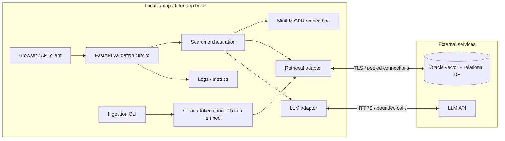
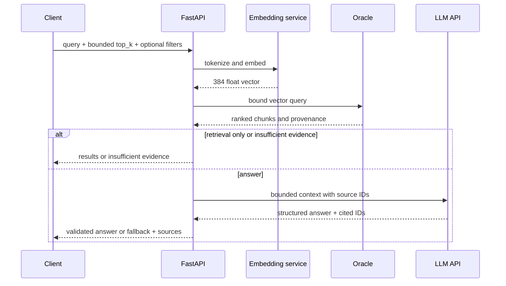

# High-level design
## Scope and boundaries
One evolving repository; V1 deterministic RAG, V2 tool-using agent. Local FastAPI, embeddings, ingestion, optional UI; cloud Oracle and external generation API. Trust boundaries: browser→API, API→DB over TLS, API→LLM provider (send minimum evidence), ingestion→untrusted corpus. No direct browser access to secrets or Oracle.

Offline flow: attributed technical sources → validation/dedup → token-aware chunks → local normalized embeddings → transaction/batch insert → counts and retrieval verification. Independent from online path. Exact search first. V2 calls the same retrieval and LLM interfaces; see AI_AGENT_DESIGN.md. No distributed deployment is claimed.
